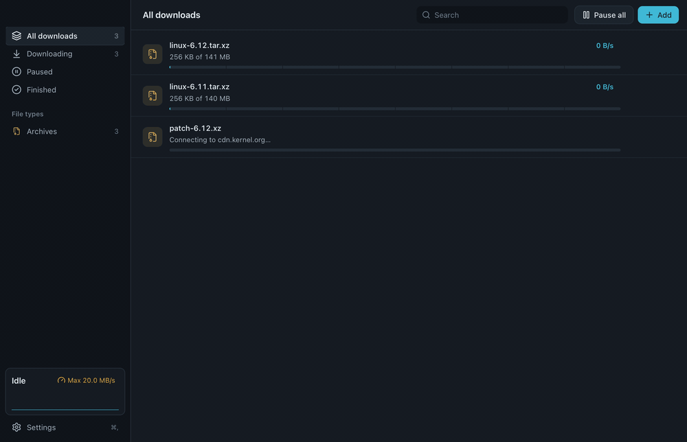
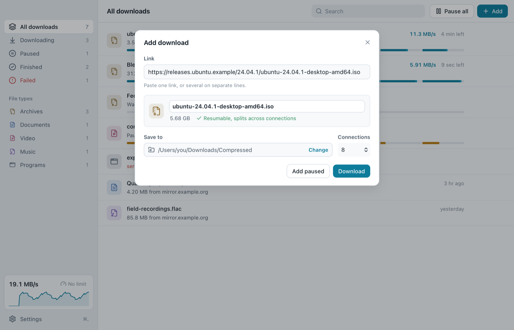

# Downpour

[](https://github.com/notzenco/downpour/actions/workflows/ci.yml)
[](LICENSE)

A fast, resumable, multi-connection download manager for Windows, macOS and
Linux. The download engine is written in Rust; the desktop app uses Tauri 2
with a React and TypeScript interface.



<sub>Real downloads from cdn.kernel.org with a 20 MB/s limit, recorded from the
engine and replayed through the interface at 2× speed.</sub>

## Why it is fast

A single HTTP connection is often limited by latency or per-connection
throttling, not by your bandwidth. Downpour splits each file into byte ranges
and fetches them in parallel:

- **Segmented downloads.** A file is divided across up to 32 connections, each
  writing its range straight to its offset in the file.
- **Dynamic re-splitting.** When a connection finishes, it takes over half of
  the largest range still in progress, so every connection stays busy until
  the last byte instead of idling while one slow range finishes.
- **Adapting to server limits.** Connections open one at a time. If a server
  refuses an extra connection (for example with HTTP 429), that range goes
  back in the queue and the download continues with fewer connections instead
  of failing.
- **One TCP connection per segment.** Requests use HTTP/1.1 on purpose: HTTP/2
  would multiplex every segment over a single TCP connection and remove the
  benefit.

Measured on one home connection in November 2026, downloading the 141 MB Linux
6.12 source tarball from cdn.kernel.org:

| Client | Connections | Throughput |
| --- | --- | --- |
| curl | 1 | 2.4 MB/s |
| Downpour | 8 | 52 MB/s |
| Downpour | 16 | 35 MB/s |

Results depend heavily on the network and the server; 8 connections is the
default because more did not help here. Run the benchmark yourself with the
command under [Development](#development).

## Features

- Pause, resume and retry, including after a crash or restart
- Queue with a configurable number of simultaneous downloads
- Global speed limit, from the sidebar or Settings
- Automatic file-type categories, optionally saved into per-type folders
- Add links by pasting anywhere in the window, dragging them in, or several
  at once; the add dialog checks size and resume support before you start
- Browser extension for Chrome, Edge, Brave, Vivaldi and Firefox that sends
  downloads to the app, with the site's cookies so signed-in downloads work
- Offer to download a link that is on the clipboard when you switch to the app
- Live connection map showing where in the file each connection is writing
- Keyboard control: Ctrl/⌘+N add, Ctrl/⌘+F search, Ctrl/⌘+, settings,
  arrow keys, Space to pause or resume, Delete to remove, Enter to open
- Runs from the system tray or menu bar (with live speed on macOS), with
  completion notifications
- Light and dark themes that follow the system



## Install

Download the installer for your system from the
[latest release](https://github.com/notzenco/downpour/releases/latest):
a `.dmg` for macOS (Apple silicon or Intel), an `.msi` or setup `.exe` for
Windows, or an `.AppImage`, `.deb` or `.rpm` for Linux. The builds are not
code-signed yet, so macOS asks you to right-click the app and choose **Open**
the first time, and Windows SmartScreen asks you to choose **More info**, then
**Run anyway**.

## Browser extension

The extension in [`extension/`](extension) catches downloads as they start and
sends them to Downpour, and adds **Download with Downpour** to the right-click
menu of links and media. Click its toolbar button to switch catching off and
on. Downloads from private windows, small files (under 256 KB), and `blob:` or
`data:` links stay in the browser, and if Downpour is not installed the browser
keeps the download.

Downpour registers itself with installed browsers when it starts, using the
browsers' native messaging, which only lets this extension talk to it. Then:

- **Chrome, Edge, Brave, Vivaldi:** unzip `downpour-extension.zip` from the
  release (or use the `extension` folder of this repository), open the
  extensions page, turn on developer mode, choose **Load unpacked** and select
  the folder.
- **Firefox:** open `about:debugging#/runtime/this-firefox`, choose **Load
  Temporary Add-on** and select `extension/manifest.json`. Temporary add-ons
  are removed when Firefox restarts until the extension is signed.

By default each link opens the add dialog so you can pick the folder; turn off
**Ask before downloading links from the browser** in Settings to start them
straight away.

**Privacy.** For each download the extension sends the link, the page it came
from, the browser's user agent and the site's cookies to the Downpour app on the
same computer, and nothing anywhere else. Downpour keeps those cookies with the
download so it can resume, in its local data folder.

## Reliability

- **Progress never overstates what is on disk.** Each connection buffers data
  and only counts bytes after they are written and flushed, so the saved resume
  offsets are always safe to continue from.
- **Atomic state saves.** The download list is written to a temporary file and
  renamed into place every two seconds while downloads run, and again on quit.
- **Server changes are detected.** On resume, a changed size, `ETag` or
  `Last-Modified` restarts the download instead of splicing two versions.

This was checked end to end by force-killing the release build partway through
a download, relaunching it, and comparing the finished file against kernel.org's
published SHA-256 checksum.

## Architecture

```
src-tauri/src/
├── engine/          download engine, independent of Tauri
│   ├── probe.rs     one request reads size, range support and file name
│   ├── segments.rs  range planning and dynamic re-splitting
│   ├── worker.rs    per-connection tasks, retries, adapting to refusals
│   ├── limiter.rs   token-bucket speed limiter shared by all connections
│   ├── mod.rs       Manager: queue, pause/resume, progress events, saves
│   ├── store.rs     atomic JSON persistence
│   └── naming.rs    Content-Disposition parsing, safe and unique file names
├── browser.rs       native messaging helper and browser registration
└── lib.rs           Tauri commands, tray, notifications, window behaviour

src/                 React interface
├── api.ts           typed bridge to the Rust commands and events
├── store.ts         app state fed by engine events
└── components/      list, connection map, dialogs, settings

extension/           browser extension (Manifest V3, Chromium and Firefox)
├── background.js    catches downloads, context menu, hands links to the app
└── capture.js       which downloads to take and what to send, kept testable
```

The browser starts the Downpour binary itself as its messaging helper. It
checks the message, passes the link to the running app (starting it if
needed) through the single-instance handover, and exits.

The engine pushes events (download updated, removed, progress every 500 ms)
and the interface renders from them; the interface never polls.

## Testing

- **Engine end-to-end tests** run against an in-process HTTP server that
  simulates range support, servers without ranges, unknown-length streams,
  missing files and per-client connection limits. They cover segmented
  downloads, pause and resume from saved offsets, recovery after a restart,
  queue limits and file-name collisions.
- **IPC contract tests** call every command through Tauri's mock runtime with
  the exact JSON the interface sends, so a renamed field on either side fails.
- **Browser integration tests** cover message framing, rejecting non-web
  links, registering only with installed browsers, cookies reaching every
  segment request, the extension's capture rules, and that the extension's key
  matches the ID the helper allows.
- **Unit tests** cover range planning, splitting, header parsing, file-name
  sanitising and the interface's formatting helpers.
- **CI** runs formatting, type checking, Clippy with warnings as errors and all
  tests on Windows, macOS and Linux.

## Development

Requirements: Rust (stable), Node 24, pnpm, and the
[Tauri prerequisites](https://tauri.app/start/prerequisites/) for your OS.

```sh
pnpm install
pnpm tauri dev      # run the app with hot reload
pnpm tauri build    # build installers into src-tauri/target/release/bundle
pnpm check          # typecheck, frontend tests, Clippy, Rust tests
```

Measure throughput against a real server (downloads from the internet, so it is
skipped by default):

```sh
cd src-tauri
DOWNPOUR_BENCH_URL=https://cdn.kernel.org/pub/linux/kernel/v6.x/linux-6.12.tar.xz \
  cargo test --locked bench_real_url -- --ignored --nocapture
```

## Roadmap

- Signed and notarized installers, and signed extension listings in the
  Chrome Web Store and Firefox Add-ons
- Scheduler, and multiple named queues
- Per-download speed limits, and entering credentials for protected downloads
- Proxy settings
- Media and whole-site grabbing
- Refreshing an expired link on a paused download
- Checksum verification in the app

## License

[MIT](LICENSE)
